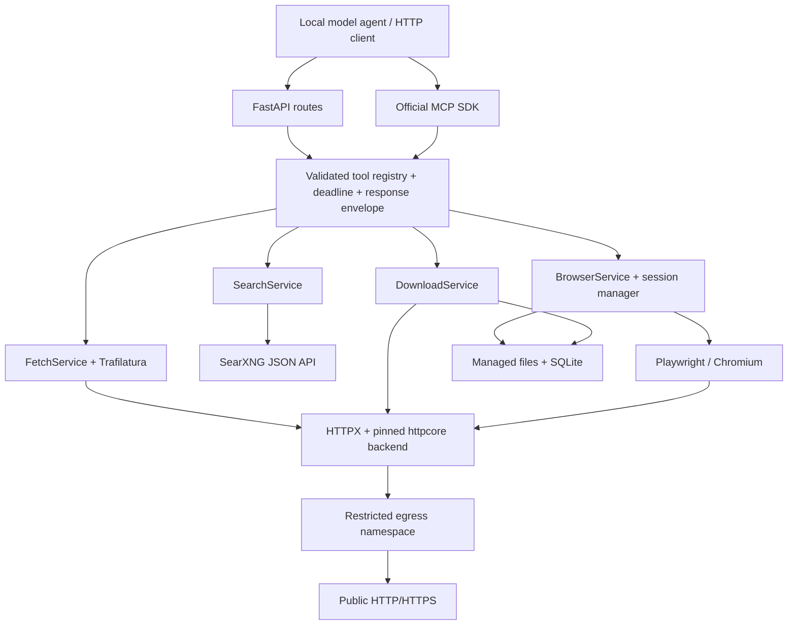

# Architecture

FastAPI owns the ASGI lifespan and the official MCP SDK's
`StreamableHTTPSessionManager.run()` context. `/mcp` uses Streamable HTTP with
stateless protocol requests. Domain browser state is explicitly session-keyed
and remains live across separate MCP requests. One process serves both transports.

`ToolRegistry` owns the input models and handlers. REST exposes the same models
in OpenAPI; MCP advertises the models as JSON Schema. Both paths dispatch through
the same validation and envelope. MCP failures additionally set `isError`.
Expected policy/upstream errors use `ToolError`; unknown exceptions are logged and
become a generic response without stack traces or sensitive inputs.

SearXNG is an administrator-configured trusted dependency. Public fetches and
downloads cannot use that client's private-network access. A custom HTTPX transport
adapts the documented httpcore network-backend extension point: DNS is resolved,
all answers are classified, and only checked IP literals reach the TCP connector.
TLS retains the original hostname. `AutoBackend` is a small internal httpcore
import, constrained by the pinned dependency and covered by integration tests.

Playwright remains an adapter behind browser services. It routes main documents
and subresources through the safe client and fulfills responses. Chromium gets a
nonfunctional proxy for any traffic missed by interception. WebSockets and service
workers are disabled. Browser cookies stay in their own contexts; shared HTTPX
clients never retain cookies. Task context, ref maps and locks belong to sessions.

File writes serialize quota accounting through a process lock, stream to exclusive
partial files, hash as written, publish without replacement, and commit metadata
to SQLite. Failed/cancelled streams remove files. Completed artifacts, including
screenshots, share the managed quota. No extraction model or inference server is
involved. A crash between publication and SQLite commit can leave an orphan counted
against quota; future maintenance should reconcile such files explicitly.

Extension boundaries are intentionally modest: services/adapters and a registry,
not queues or microservices. Add cache/extraction adapters when needed. Multiple
workers require shared session ownership, approvals and quota synchronization.

SDK reference: [official Python SDK](https://github.com/modelcontextprotocol/python-sdk).
Network extension: [httpcore network backends](https://www.encode.io/httpcore/network-backends/).
